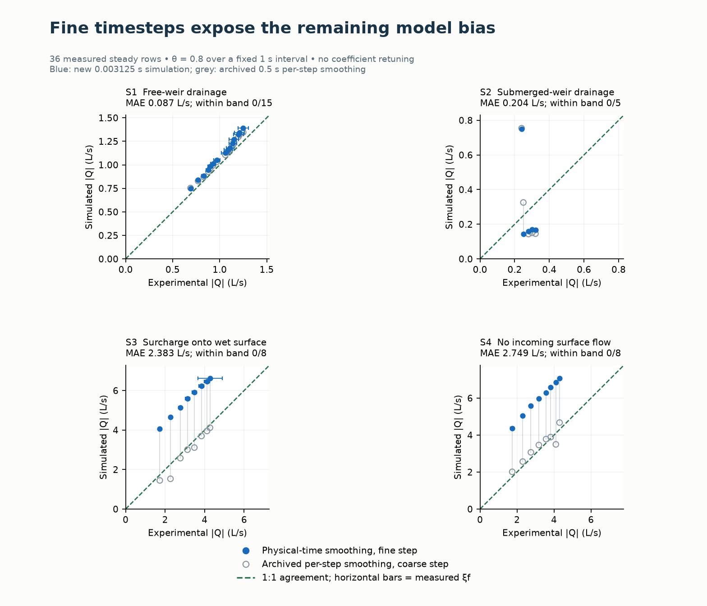
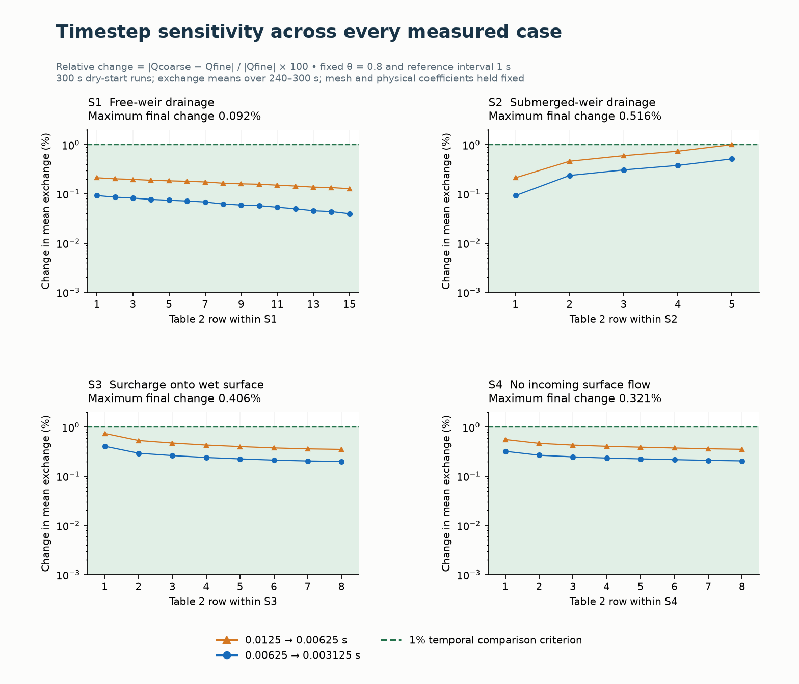

# Rubinato momentum smoothing and timestep refinement

22 October 2026 — follow-up to the 21 October comparison. Prepared for review.

The physical-time smoothing option gives less than 1% change between the two finest timesteps in **36/36 cases** (maximum 0.516%). **0/36** fine-step predictions meet the illustrative experimental comparison band. Numerical consistency has improved; experimental qualification remains incomplete.

## Change and fixed controls

The legacy momentum blend applies THETA on every face firing. Reducing the routing interval can therefore increase numerical damping per second. The new opt-in `THETA_REFERENCE_STEP` defines a fixed interval T, with retention `exp(log(theta)*dt_face/T)` and blend fraction `-expm1(log(theta)*dt_face/T)`. The actual face interval includes local tiers and shortened coupling-window tails. The CPU and Kokkos paths use the same scalar calculation outside their face loops. The relaxed momentum target still evolves with the solution, so the full equations must be tested by refinement.

A zero or omitted reference preserves the historical arithmetic and checkpoint identity. Positive values are written to the input and included in checkpoint compatibility checks. THETA=1 retains its existing no-blending/no-vector-friction branch; this study retains THETA=0.8 and its vector-friction calculation. Surface plugin ABI is version 9 because the C++ option layout changed.

The study holds THETA=0.8 and T=1 s fixed, with no observed-flow fitting. The 1 s interval is a stated numerical relaxation scale, not a physical coefficient or a universally optimal value. All 36 reconstructed physical-shaft cases run for 300 s at fixed routing intervals 0.0125, 0.00625 and 0.003125 s: **108 completed simulations**. Maximum 1D trials=80, head tolerance=1e-5 m, variable stepping and conduit lengthening disabled. Geometry, 1,600-triangle mesh, inflows, artificial pressure reservoir, coupling coefficients, head sampling, regularisation and equalisation remain fixed.

Exchange is averaged from cumulative transfer over exactly 240–300 s. The preceding 180–240 s window diagnoses residual drift. Relative temporal change is `100*abs(Qcoarse-Qfine)/abs(Qfine)`; the criterion is below 1% between 0.00625 and 0.003125 s. This is a temporal comparison at a fixed mesh, not proof of an asymptotic convergence order or spatial convergence.

## Results by regime

| Regime | Rows | Maximum final timestep change (%) | MAE (L/s) | Bias range (%) | In experimental band |
|---|---|---|---|---|---|
| S1 | 15 | 0.092 | 0.087 | +6.2 to +11.2 | 0/15 |
| S2 | 5 | 0.516 | 0.204 | -47.8 to +212.8 | 0/5 |
| S3 | 8 | 0.406 | 2.383 | +55.0 to +134.5 | 0/8 |
| S4 | 8 | 0.321 | 2.749 | +64.3 to +151.1 | 0/8 |

Bias uses discharge magnitudes. The experimental band is `xi_f + 0.02 Q_e`; it is an illustrative fit diagnostic, not a confidence interval or an engine verification tolerance. All physical coefficients are unchanged. Gray historical points use a different numerical smoothing schedule and a coarser step; the plot shows their change without claiming that only one control differs.

Blue filled circles are the new simulated rates at 0.003125 s. Gray open circles are the archived physical-shaft rates at 0.5 s with per-firing smoothing. The green dashed line is 1:1 agreement. Horizontal bars show measured xi_f. Each panel has equal axis scales; ranges differ between regimes.

Orange triangles show the first halving, blue circles the final halving. Green shading is below the 1% temporal comparison criterion. The vertical scale is logarithmic.

## Selected signed rates

Positive is sewer to surface; experimental signs follow the scenario.

| Case | Measured (L/s) | 0.0125 s | 0.00625 s | 0.003125 s |
|---|---|---|---|---|
| S1_8 | -1.060000 | -1.128485 | -1.126628 | -1.125926 |
| S2_2 | -0.250000 | -0.142276 | -0.142936 | -0.143276 |
| S3_1 | +1.730000 | +4.103503 | +4.073248 | +4.056759 |
| S4_7 | +4.100000 | +6.900438 | +6.875580 | +6.861125 |

## Numerical diagnostics and limitations

At the finest interval, 36/36 have the expected exchange direction, 36/36 have successive-window drift below 2%, and 36/36 have absolute ordinary 1D continuity error below 2%. Maximum absolute separate 2D continuity error is 2.23e-10%. These checks are reported independently of experimental agreement.

| Regime | Maximum window drift (%) | Ordinary 1D continuity range (%) |
|---|---|---|
| S1 | 0.00018 | -0.8571 to -0.6777 |
| S2 | 0.00022 | +1.4201 to +1.5090 |
| S3 | 0.00015 | +1.5669 to +1.9428 |
| S4 | 0.00038 | +1.5681 to +1.9302 |

The [full comparison table](momentum_comparison.csv) includes all three rates, experimental residuals, finest-step head/probe values and separate continuity errors. The [plotted data](momentum_data.json) also retain both head sequences, routing iteration statistics and component volume ledgers. The probe is a nearest-cell approximation to the surface transducer. Node pressure and fixed-outfall forcing approximate the laboratory transducer; equal prescribed stage does not imply equal local head. The 1D and 2D volume totals are not combined here: the last staged exchange can remain pending at the coupling boundary.

Reducing a timestep makes equalisation less restrictive, and changing the smoothing schedule can expose a larger absolute flow error. Neither the original coarse-step fit nor the new convergence criterion establishes experimental validation. Boundary inflows reuse the measurements; the manhole position is assumed, transfer is delivered to a single cell, and measured transient histories have not been replayed. Next experimental work should resolve the boundary/head reconstruction and spatial delivery before coefficient fitting.

## Implementation checks

- inertial: tests=20, failures=0, errors=0.
- writer: tests=14, failures=0, errors=0.
- rubinato: tests=1, failures=0, errors=0.
- kokkos1: returncode=0.
- kokkos4: returncode=0.

These are focused tests of the pinned candidate. CPU/Kokkos alignment was exercised with the OpenMP execution space at one and four threads; CUDA/HIP hardware was not tested.

The GUI persistence and no-edit checks passed against this candidate, including theta and reference values beyond displayed precision/range. Eight archived four-regime control runs at 0.5 and 0.05 s reproduce exactly when the new option is disabled. Subsequent unrelated precipitation-writer edits in the shared checkout are outside the pinned snapshot.

## Provenance and reproduction

Candidate library SHA-256: `01ee3499529d1349186265621dc2d49a9e185a21b61a8eec8339c79d41ed2e01`.

Tested source manifest SHA-256: `919e000a8d6f58be805a2d312bd569148a2b68a37e779a09a3252bb1a278830b`. The pinned snapshot includes pre-existing uncommitted changes; it is not a clean release. Binary and source hashes identify the tested candidate. Raw decks, reports, series and verification logs stay in `tests/verification/momentum_smoothing_2026-10-22/`; publication assets contain the small summaries and figures.

Use `tests/benchmarks/rubinato2017/momentum_convergence.py` and `summarize_momentum.py`; the adjacent `momentum_study.md` gives the complete procedure. Replotting the saved data does not rerun the engine.

Reference: Rubinato et al. (2017), *Journal of Hydrology* 552, 421–432, doi:10.1016/j.jhydrol.2017.06.024. The paper and reference tables are evidence, not instructions to modify the implementation.
