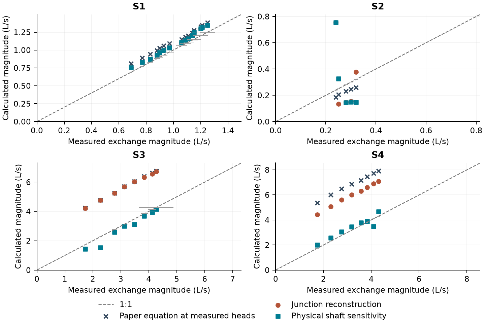
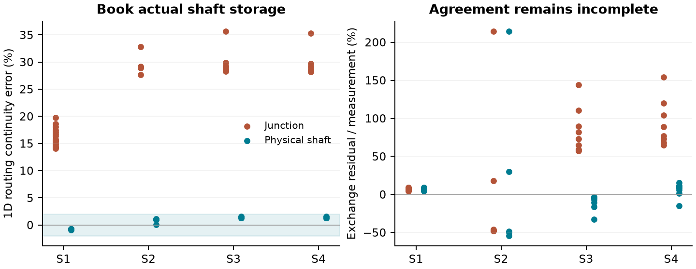
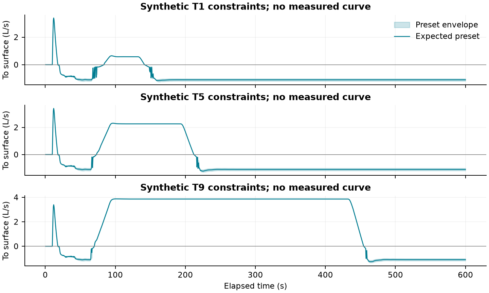

# Fine-scale 1D/2D coupling: review of Rubinato et al. (2017)

**Review draft - 21 October 2026. Experimental qualification is incomplete.**

The implemented coupling features pass their focused engine checks. The comparison with the laboratory measurements does not yet support calling the reconstructed OpenSWMM flume experimentally validated. This report retains the discrepancies, separates numerical checks from measured agreement, and provides draft material for the hydraulic reference manual and SWMMVis example documentation. Publication in those manuals is pending review.

## Outcome at a glance

| Scenario / n | Paper eq. bias (%) | Junction bias (%) | Shaft bias (%) |
| --- | --- | --- | --- |
| S1 / 15 | +8.3 to +17.7 | +4.4 to +9.2 | +4.4 to +9.2 |
| S2 / 5 | -23.3 to -17.3 | -48.1 to +214.6 | -54.4 to +214.3 |
| S3 / 8 | +58.5 to +144.6 | +57.3 to +144.1 | -32.5 to -3.6 |
| S4 / 8 | +84.1 to +208.3 | +65.0 to +154.4 | -14.7 to +15.7 |

Bias is 100 (calculated magnitude / measured magnitude - 1). Each range covers every Table 2 row in that scenario. These are goodness-of-fit diagnostics on the calibration measurements, not independent validation or numerical convergence estimates.
The full-engine table uses a 0.5 s routing step; the representative 0.05 s checks below show that it is not a converged experimental comparison. The broader suite records **59 numerical passes and 56 numerical failures**, with no execution errors. Measured-flow agreement is reported separately.

## What was already complete

- Engine: shared CPU/device exchange law; free/submerged weir and orifice regimes; coefficient overrides; surface-head options; conservative exchange booking; pond modes and equalisation; outfall tailwater, spreading and reporting; node attributes, INP/GeoPackage and C/Python access.
- SWMMVis: node coupling edits and selector, meshing eligibility, remap preview/undo, unauthored map coefficients, options and INP persistence. The prior handoff still lists map styling by eligibility and per-node mapper-law precedence as follow-ups.
- Earlier evidence: Tables 1-3 transcribed, law regression and reconstructed steady flume tests, a fine-mesh anti-choking check, and churn comparisons. The standalone benchmark decks lacked metadata and a runnable coupling suite.

## Completed in this review

The benchmark now has six validated metadata/provenance records and a runnable coupling suite. Run completion, head samples, two successive steady windows and continuity are exported. A physical-shaft sensitivity explicitly books the 0.04524 m2 shaft volume and uses that area as MIN_SURFAREA; the former numerical floor was about 1.167 m2, or 25.8 shaft areas. No discharge coefficient was retuned.

Two reconstruction errors were corrected: Q3 is now obtained from Table 2's definition of surcharge percentage, rather than identifying pipe Reynolds flow as inlet flow; and synthetic timestamps now use hours:minutes:seconds, placing the pulse within the 600 s run. The synthetic example also uses actual shaft storage and an explicitly assumed 0.45 m downstream stage so that both transfer directions occur.

<!-- pagebreak -->

## 1. What the paper measures

The no-lid rig has a 0.24 m manhole, a 0.075 m pipe, an 8 m by 4 m flume, slope 0.001, Manning n = 0.009 and crest 0.478 m above the pipe invert. S1 is free-weir drainage into an unsurcharged sewer (15 rows); S2 is submerged-weir drainage (5); S3 is sewer discharge onto a wet surface (8); S4 is sewer discharge with no incoming surface flow (8). S4 has no tabulated surface head. Equation 3's surface-to-sewer orifice coefficient was not calibrated by these experiments.

For this report, L = pi D, A = pi D squared / 4 and all heads share the pipe-invert datum. The isolated paper terms are X1 = (2/3) L sqrt(2g) hs to the power 3/2; X2 = L sqrt(2g) hs sqrt(hs + z - hp); X3/X4 = A sqrt(2g) sqrt(hp - hs - z). Calculated magnitude is C X. This calculation has no smoothing, availability cap or modelled surface response.

| Scenario | Paper C | Recovered slope | Intercept (L/s) | R-squared |
| --- | --- | --- | --- | --- |
| S1 | 0.540 | 0.5341 | -0.105 | 0.9908 |
| S2 | 0.056 | 0.0608 | +0.033 | 0.9680 |
| S3 | 0.167 | 0.1651 | -2.461 | 0.9981 |
| S4 | 0.160 | 0.1634 | -3.797 | 0.9973 |

The recovered slopes are from ordinary fits Q = C X + b using the rounded Table 2 data. The paper's Figures 6-9 display nonzero intercepts; Table 3 gives their slopes. In particular, the S3/S4 intercepts are large relative to the measured flows. High R-squared and matching slopes therefore do not establish absolute discharge agreement: the bare zero-intercept paper equations meet xi_f + 2% of measured flow in **0/36** rows. The corresponding physical-shaft runs meet that illustrative band in **8/36** rows. The band is a comparison criterion, not a statistical confidence interval.

Horizontal bars show the paper's xi_f instrument/balance variation. Each panel uses its own scale. The dashed line is equality. Paper equation points use measured heads; the other points use independently evolved surface heads and reconstructed boundary conditions.

<!-- pagebreak -->

## 2. Full-engine reconstruction and conservation

Both steady variants use 1,600 triangular cells at nominal 0.2 m spacing, dynamic-wave routing at 0.5 s, a central manhole, STENCIL_WET_MEAN and the RUBINATO2017 preset. They run 300 s from a dry start. Exchange is the cumulative transfer difference over 240-300 s, compared with 180-240 s for drift. A short, wide downstream pipe imposes the measured sewer stage approximately; this is an artificial head reservoir, not the laboratory's complete sewer system.

Surface inflow is reconstructed as Q1 = Fr sqrt(g hs) hs W, assuming representative uniform velocity across the 4 m width. S4 has Q1 = 0. Sewer inflow is Q3 = absolute(Qe / (percentage / 100)) for S2-S4, and zero for S1. These inputs reuse the measured calibration rows, so the exercise is not a blind prediction. Fr and Reynolds entries contain apparent inconsistencies in the article and should not be silently 'corrected'.

| Scenario | Shaft continuity (%) | Max drift (%) | Within xi + 2% | Numerical gates |
| --- | --- | --- | --- | --- |
| S1 | -0.88 to -0.70 | 0.00 | 3/15 | 15/15 |
| S2 | +0.05 to +1.13 | 22.22 | 0/5 | 4/5 |
| S3 | +1.28 to +1.54 | 48.24 | 4/8 | 6/8 |
| S4 | +1.28 to +1.58 | 25.01 | 1/8 | 6/8 |

Numerical gates require completion, correct exchange direction, at most 2% successive-window drift and at most 2% absolute ordinary 1D routing continuity error. Observed discharge fit remains report-only. The engine's historical unit test only guarded direction and severe choking; it was never an experimental accuracy gate.

The shaft variant changes the storage representation and the numerical area floor together; the improvement cannot be assigned to either change alone. It improves conservation substantially, but residual continuity or drift failures remain visible. Continuity is the ordinary 1D ledger over the whole run, not a coupling-only error or a combined-domain balance.

## Routing-step sensitivity

| Selected case | Q at 0.5 s (L/s) | Q at 0.05 s (L/s) | Drift at 0.05 s (%) |
| --- | --- | --- | --- |
| S1_8_SHAFT | -1.106 | -0.951 | 0.00001 |
| S2_2_SHAFT | -0.326 | -0.137 | 0.00004 |
| S3_1_SHAFT | +1.449 | +3.799 | 0.00000 |
| S4_7_SHAFT | +3.498 | +6.649 | 0.00015 |

One case per scenario was selected by the largest 0.5 s window drift. Reducing the routing step stabilises those windows but changes discharge materially. Some apparent coarse-step agreement with measurements is therefore unreliable. This two-step sensitivity is not a time-convergence study; the full steady matrix above remains a 0.5 s diagnostic. Signed rates here are positive to the surface.

<!-- pagebreak -->

## 3. Unsteady results: synthetic demonstration, not measured validation

The corrected demonstration uses the nine Table 1 peak ratios and durations, constant surface inflow 8.15 L/s, a 30 s rising ramp beginning at 60 s, a plateau of the stated duration and a 30 s falling ramp. All runs last 600 s. The paper instead used measured sewer pressure at each timestep and evaluated 500 s events. Matching a peak ratio and duration does not recreate those pressure histories or measured exchange series.

| Event | Peak Q3/Q1 | Plateau (s) | Spill (m3) | Drain (m3) | Continuity (%) |
| --- | --- | --- | --- | --- | --- |
| T1 | 0.65 | 41 | 0.044 | 0.544 | 1.65 to 1.71 |
| T2 | 0.66 | 66 | 0.062 | 0.516 | 1.61 to 1.66 |
| T3 | 0.68 | 131 | 0.118 | 0.443 | 1.49 to 1.53 |
| T4 | 0.96 | 67 | 0.202 | 0.506 | 1.46 to 1.49 |
| T5 | 0.97 | 102 | 0.286 | 0.467 | 1.36 to 1.39 |
| T6 | 0.98 | 201 | 0.522 | 0.358 | 1.15 to 1.16 |
| T7 | 1.26 | 102 | 0.492 | 0.464 | 1.22 to 1.24 |
| T8 | 1.26 | 197 | 0.859 | 0.360 | 0.99 to 1.00 |
| T9 | 1.26 | 341 | 1.415 | 0.201 | 0.77 to 0.77 |

Spill/drain columns use the expected preset. Continuity ranges cover lower/expected/upper presets; **27/27** runs pass the synthetic checks, including nonnegative depth, both transfer directions, at least two reversals and the 2% 1D continuity criterion. Signed net transfer may be negative even when substantial surcharge occurs; gross spill and drain must be reported separately.

Curves are OpenSWMM output only. Shading is the envelope of the three coefficient presets, not experimental uncertainty. No observed transient curve is plotted. The source paper reports excess numerical surcharge and sensitivity to head sampling, but that qualitative finding cannot validate this different forcing. Its HMho approach generally improves longer-event agreement; the text also reports shorter events for which other head definitions are closer. The end-of-surcharge suction oscillation requires physics beyond this depth-averaged coupling model.

<!-- pagebreak -->

## 4. Fine mesh, limitations and publication decision

The existing fine-mesh S3 check has **9,600 cells**, with 0.0125 m grid spacing near the manhole, rather than the paper's 11,186-cell mesh. Equalisation on/off gives **3.4146 / 3.4146 L/s**, ratio **1.0000**. It passes the anti-choking criterion; this does not demonstrate spatial convergence. The junction exchange is concentrated into one delivery cell even when its opening covers many cells. Its fine-mesh continuity is **35.93%** and is not hidden by the anti-choking result.

The law-only regression uses a lab-scaled square-root regularisation head of 0.02/6 m. The routed model retains the engine's 0.02 m regularisation, inside the measured millimetre-scale head range. The preset also uses COO = 0.160 for both wet and dry outward flow, whereas the paper's wet S3 slope is 0.167; COI = 0.167 is borrowed for inward orifice flow and is not calibrated by this paper. Near the S2 crest, blending and millimetre-rounded pressure values further affect comparisons. No compensating intercept or new coefficient fit has been added to hide these differences.

Focused verification: **93 tests in 16 engine programs passed**, followed by the new physical-shaft test. Five of six GUI programs passed against the existing private 1D/2D install; mesh-engine sync reproduced its two previously reported fixture initialisation failures. These GUI checks use that earlier engine install, not the pinned report binary. GPU runtime accuracy, TRACKING restart support, map styling and per-node mapper precedence are not certified by this CPU/laboratory report.

The exported surface probe is the nearest centroid to the assumed point 0.46 m upstream of the central manhole; on the coarse mesh it is at (3.5333, 2.0667) m, rather than the exact transducer position. Its depth and the modelled manhole head are in steady_comparison.csv. Table 2's pipe pressure was measured 0.35 m away; prescribing it as manhole head omits those local losses. STENCIL_WET_MEAN also does not reproduce the paper's average over every cell inside the circular opening.

## Required before an experimental validation claim

1. Obtain and archive the measured transient sewer-head and exchange time series, or make a separately reviewed digitisation of Figures 5, 10 and 11 with uncertainty and event identification. The DOI supplementary endpoint was not retrievable in this review; the Sheffield project outputs page does not expose an associated 2017 data link. This is not evidence that raw data do not exist.
2. Resolve all physical-shaft continuity/steadiness failures; demonstrate routing-step and mesh refinement while sampling the actual transducer position and opening footprint. Compare both domain ledgers and the combined balance.
3. Review the lab-scale regularisation, head sampling, local pipe losses and single-cell delivery assumptions before changing runtime physics. Any coefficient recalibration on Table 2 must be labelled calibration and evaluated on independent measured events.

**Publication recommendation:** retain the report and runnable example as a qualified comparison and numerical demonstration. The manual drafts must carry the limitations and measured-fit table. Do not describe the case as an experimentally validated 1D/2D solver example. Manual navigation and published pages have not been changed; review the accompanying drafts first.

## Reproducibility and evidence

The benchmark suite output includes every generated deck, report, transient series, steady CSV, numerical gate result, and a SHA-256 binary manifest. The recorded engine identifier is `52ffb504-dirty`; it denotes a dirty shared checkout, not a clean release. The executable/library hashes identify the actual pinned binaries, which were retained locally to isolate this sweep from concurrent engine work. The report's results_summary.json contains those hashes and the complete scenario summaries. steady_comparison.csv preserves all 36 measured rows and both full-engine variants.

Run the native test build, then the benchmarks entry point with --suite coupling, --native-bin pointing at its bin directory and --library pointing at the engine shared library. Set --output-dir to a new review directory. A nonzero suite status reports numerical gate failures even though observed fit is report-only. Regenerate this report with tests/benchmarks/rubinato2017/summarize.py --run-dir [suite output] --output [report folder]. See the benchmark suite README for complete commands and prerequisites.

Source: Rubinato, M., Martins, R., Kesserwani, G., Leandro, J., Djordjevic, S., and Shucksmith, J. (2017). Experimental calibration and validation of sewer/surface flow exchange equations in steady and unsteady flow conditions. Journal of Hydrology 552, 421-432. DOI: https://doi.org/10.1016/j.jhydrol.2017.06.024. Tables 1-3; Figures 2, 6-11; Sections 3.1, 3.2.1 and 4.4. Source tables are CC-BY-4.0; original numerical decks are CC0-1.0. Data availability check: https://sheffield.ac.uk/floodinteract/outputs (21 October 2026).
